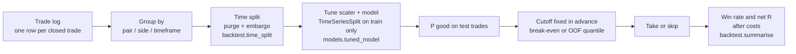

# Trading Algorithm Backtester: trade-quality classifiers

[](https://github.com/Avinash186200/trading-algorithm-backtester/actions/workflows/ci.yml)  [](LICENSE)

## What problem this solves

A simple trading rule wins some trades and loses others. If a model could tell, at the moment of entry, which trades are likely to lose, you could skip them. This repo tests that idea honestly: the model only learns from earlier years, the skip rule is fixed before looking at the test years, and costs are charged.

## Overview

I built this to answer one question about a rule-based trading strategy: can a classifier, using only what is known at entry, tell which trades will hit take-profit and which will hit stop-loss, well enough to skip the bad ones after costs?

The original 2021 research ran a base strategy on several FX pairs, long and short, on daily bars. It trained random forest, SVM and neural network models per pair / direction / timeframe, and compared them in lift tables. The trade logs are proprietary and are not in this repo. Everything here runs on a **synthetic trade log with the same columns**, so you can clone it and reproduce every number below.

## At a glance

| | |
|---|---|
| **Input** | One row per closed trade: `date, Currency, Condition, TimeFrame, TP_Ratio`, entry-time features `f_00..f_11`, `Close_Flag`, `Good_Bad_Flag`, `Profit` |
| **Method** | Per-group time split (train up to year N, test after, with an embargo); logistic regression, random forest, SVM and a small MLP, each tuned with time-ordered CV on training data only |
| **Output** | Out-of-sample P(good) per trade, a take/skip decision, baseline-vs-filtered win rate and net R after costs, a decile lift table |
| **Leakage controls** | Scaler inside the pipeline, cutoff fixed by rule (break-even) or from out-of-fold *training* probabilities, embargo at the split, one pre-chosen configuration, noise test in CI |
| **Status** | Method rebuilt and leak-free on synthetic data. The original real-data results are not published because they were produced with test-set threshold selection (see audit) |

## What you will learn

- How to frame "should I take this trade?" as a binary classification problem with a cost-aware decision rule.
- How to split time-ordered data without leaking the future: a time split, a purge before the cutoff and an embargo after it.
- Why scaling and hyper-parameter tuning must happen inside the training data, with time-ordered folds.
- Why a probability cutoff chosen on the test set is not a result, and two ways to fix the cutoff in advance.
- Why in-sample probabilities from a random forest are useless for picking a cutoff, and what out-of-fold probabilities are.
- How to read a lift table, and how to check a model with a planted signal and with pure noise.

## Key concepts

- **Take-profit and stop-loss.** Each trade closes either at a profit target or at a loss limit. Here the label is `Good` (take-profit hit) or `Bad` (stop-loss hit).
- **R (risk unit).** Profit measured in units of the amount risked. A stop-loss is -1 R; a take-profit is +`TP_Ratio` R.
- **Reward/risk ratio (RR).** `TP_Ratio`: how many R a winning trade makes.
- **Break-even probability.** The win rate at which a trade with reward/risk RR makes zero on average: 1 / (RR + 1). At RR = 2 that is 33%.
- **Time split.** Train on earlier years, test on later years. Never shuffle trades across time.
- **Purge and embargo.** Drop trades right before and right after the split date, so no trade's outcome straddles the boundary.
- **Time-ordered cross-validation (`TimeSeriesSplit`).** Tuning folds where each validation block comes after its training block.
- **Out-of-fold (OOF) probabilities.** Predictions on training rows made by a model that did not see those rows.
- **Lift (decile) table.** Sort test trades by predicted P(good), cut into ten equal groups, and compare win rates from top to bottom.
- **Selection bias.** Trying many cutoffs or configurations on the test set and reporting the best one overstates the result.

## How it works



```
trade log ──► time split + embargo ──► tuned pipeline (scaler + model) ──► P(good) ──► cutoff ──► take / skip ──► net R after costs
 (CSV)        backtest.time_split      models.tuned_model                               rule        backtest.summarise
```

1. **Group** trades by `Currency / Condition / TimeFrame`, as the original did. Each group gets its own model.
2. **Split by time**: train on trades up to 31 Dec of `--train-end-year`, purge training trades entered in the last 10 days before the cutoff (their outcome may resolve in the test period), drop a 10-day embargo after it, test on everything after.
3. **Tune** each model with a small grid and `TimeSeriesSplit` on training rows only. Scaling happens inside the pipeline.
4. **Cutoff** (pick one before running):
   - `breakeven` (default): take a trade if P(good) >= 1 / (RR + 1), the win rate at which a trade with reward/risk RR breaks even. Nothing is fitted.
   - `quantile`: keep a fixed fraction, using the quantile of **out-of-fold training** probabilities.
5. **Score** the test years once and compare with taking every trade, after a fixed cost per trade.

## Results on synthetic data

These numbers come from a synthetic trade log, not real trades. I planted a known signal in two features so there is something to find.

`python scripts/run_backtest.py` (seed 7, 3,000 trades, train 2011-2018, test 2019-2020, break-even rule, cost 0.05 R per trade):

| Model | Trades kept | Win rate (base -> filtered) | Net R per trade (base -> filtered) |
|---|---|---|---|
| Logistic regression | 51% | 38.7% -> 49.2% | -0.10 -> +0.20 |
| Random forest | 53% | 38.7% -> 46.6% | -0.10 -> +0.15 |
| SVM (RBF) | 56% | 38.7% -> 46.6% | -0.10 -> +0.14 |
| MLP (16-8) | 58% | 38.7% -> 40.7% | -0.10 -> +0.03 |

The generator plants a known, modest signal in two features. The point of the table is that the pipeline **recovers a planted signal and does not invent one**: with `--signal 0`, the filter's lift in win rate and R per trade averages around zero over several seeds, and that is a test in CI. An earlier version used the original 8-4-2 MLP with early stopping; it collapsed to a constant prediction and took every trade. The cause was structural (a ~60-row random validation split stopped training after a few epochs, behind a 2-unit bottleneck), so I changed the architecture to 16-8 without early stopping and a stronger L2 grid, and checked it on seeds 1, 2, 3 and 7 rather than only on the seed in this table. It is still the weakest model here.

**Statistical caveat.** This is one split with 608 test trades, about 300 of them kept. With a per-trade R standard deviation of roughly 1.3, the standard error of filtered R per trade is about 0.07, so the MLP's +0.03 is indistinguishable from the baseline, and the gaps between logistic regression, random forest and SVM are not significant either. Only the filter-vs-baseline gap for the first three models is clearly larger than the noise, and that is on data where I planted the signal.

> **About the real data.** I don't publish real-data figures. The original notebooks picked the probability cutoff after looking at test-year results (see the audit below), so their numbers are optimistic by construction. I have not re-run the corrected method on a final hold-out, so I make no performance claim.

## Leakage and bias audit

Found in the original 2021 notebooks and fixed here. Details in [docs/methodology.md](docs/methodology.md).

| Issue | Effect | Fix |
|---|---|---|
| Percentile cutoffs and break-even offsets (+-5..20%) were scanned on the **test** years and the best one reported | Threshold fitted on test data; selection bias | One rule fixed in advance; quantile cutoff only from out-of-fold training probabilities |
| "Train rank 1" threshold chosen from **in-sample** training probabilities | A random forest's in-sample probabilities are near 0/1, so the chosen threshold says nothing about new data | Out-of-fold probabilities with `TimeSeriesSplit` (`oof_probs`) |
| Features read from a file standardised over **all years** before the split | Test-period mean/variance leaks into training | `StandardScaler` inside the pipeline, fitted on training rows only |
| Grid search with shuffled 5-fold CV | Future trades used to tune hyper-parameters for past ones | `TimeSeriesSplit` |
| Many iterations (models x seeds x feature subsets x oversampling on/off) compared on the same test years | Best-of-N selection bias | One configuration chosen up front; all four models reported, including the one that failed |
| Feature-importance ranking files built outside the train/test loop (provenance unknown) | Possible use of test data in feature selection | Dropped; no feature selection step |
| No gap between the last training trade and the first test trade | Trades open across the boundary overlap both sets | 10-day purge before and 10-day embargo after the cutoff (assumes trades last under 10 calendar days; the log has no exit date) |
| Results reported in gross profit | Overstates edge | Fixed cost per trade (`--cost`, default 0.05 R) |

Undersampling of the majority class was applied to training rows only in the original, which is correct. It is kept as an option (`--balance`).

## Repo layout

```
src/tradeclf/
  data.py          synthetic closed-trade log with an optional planted signal
  models.py        scaler + classifier pipelines, small grids, time-ordered tuning
  backtest.py      time split with purge and embargo, OOF probabilities, cutoff rules,
                   summary and decile lift
scripts/
  run_backtest.py  command-line entry point; prints the summary, writes CSVs with --out
tests/
  test_backtest.py split + embargo, undersampling, break-even, cutoff independence,
                   OOF check, noise test, planted-signal test
docs/
  README.md        index
  methodology.md   method notes and the bias audit in full
  walkthrough.md   a guided first run, and how to read each output
original/          the original research code (read-only)
```

## Quick start

```bash
pip install -r requirements.txt
python -m pytest -q
python scripts/run_backtest.py                       # synthetic, break-even rule
python scripts/run_backtest.py --signal 0            # pure noise: no edge
python scripts/run_backtest.py --rule quantile --keep 0.6
```

Each run takes a minute or two: it tunes four models on four groups. Your own trade log needs the columns listed under "At a glance". To try the CSV path first, write the synthetic log to a file and run on that:

```bash
python -c "import sys; sys.path.insert(0, 'src'); from tradeclf.data import make_synthetic_trades; make_synthetic_trades().to_csv('your_trades.csv', index=False)"
python scripts/run_backtest.py --trades your_trades.csv --train-end-year 2018 --out results
```

This gives the same table as the default run, and writes `results/summary.csv` and `results/scored_test_trades.csv`.

[docs/walkthrough.md](docs/walkthrough.md) goes through a first run step by step.

## Original research code

[`original/`](original/README.md) holds the code as I first wrote it for this project. It is kept so you can
read the first version alongside the maintained one; some of it contains the issues in the audit table above,
and comparing the two shows each fix.

## License

MIT

See [CONTRIBUTING.md](CONTRIBUTING.md) and the [CHANGELOG](CHANGELOG.md).
